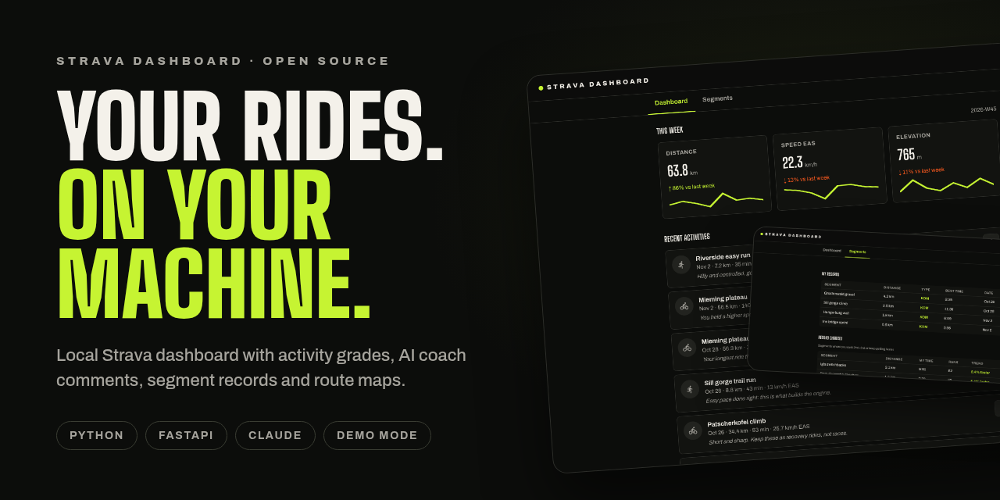
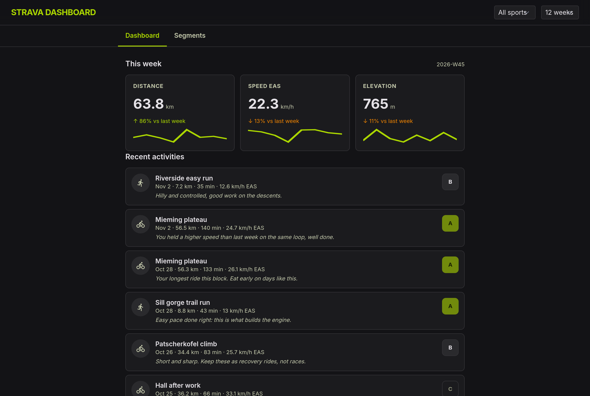
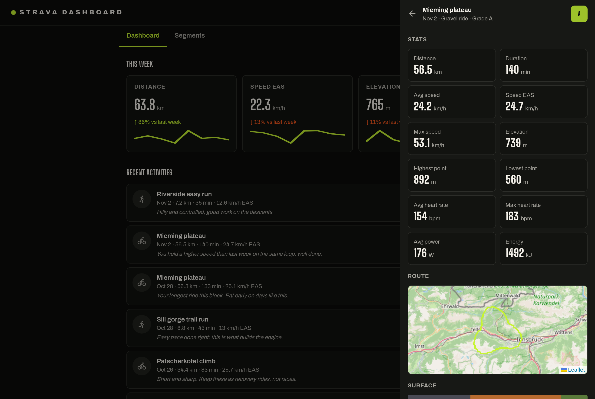
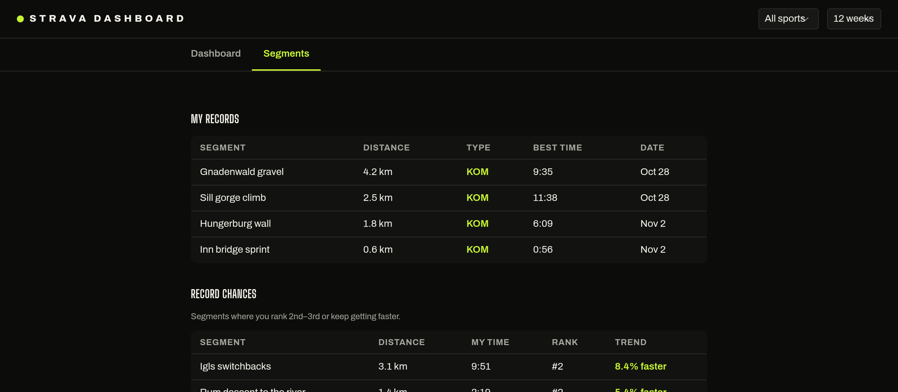

<p align="center"></p>

<h1 align="center">Strava Dashboard: a local, self-hosted Strava stats dashboard</h1>

<p align="center"><strong>Syncs your Strava activities into SQLite and shows weekly trends, A+ to C grades, AI coach comments from Claude, segment records and route maps with surface types. Runs on your computer; try it without a Strava account in demo mode.</strong></p>

<p align="center">
  <a href="https://www.python.org/"></a>
  <br>
  <a href="https://fastapi.tiangolo.com/"></a>
  <a href="https://developers.strava.com/"></a>
  <a href="https://docs.claude.com/"></a>
  <a href="#try-it-in-30-seconds"></a>
  <a href="#tests"></a>
  <a href="LICENSE"></a>
  <a href="https://github.com/BrickyStudios/strava-dashboard/commits/main"></a>
</p>

<p align="center">
  <a href="#try-it-in-30-seconds">Try it</a> ·
  <a href="#connect-your-strava-account">Connect Strava</a> ·
  <a href="#what-it-shows">What it shows</a> ·
  <a href="#how-grades-work">How grades work</a> ·
  <a href="#mcp-server-for-claude-desktop">MCP server</a>
</p>

## Try it in 30 seconds

Needs [uv](https://docs.astral.sh/uv/). No Strava account, no API key:

```bash
git clone https://github.com/BrickyStudios/strava-dashboard
cd strava-dashboard
uv run dashboard.py --demo
```

Your browser opens `http://localhost:8080` with half a year of made-up rides and runs around Innsbruck, including grades, coach comments, surface types and segments. Demo mode doesn't contact Strava, Claude or the surface lookup; the page only loads its map tiles, fonts and scripts.

<p align="center">
  
</p>

## Connect your Strava account

1. Create an app at [strava.com/settings/api](https://www.strava.com/settings/api). Any name works; set **Authorization Callback Domain** to `localhost`.
2. Run `uv run auth.py` and paste the client ID and secret when asked. Strava's consent page opens; allow access to your activities. The tokens land in `.env`.
3. Run `uv run sync.py`. The first run loads your whole history. Segment details need one request per activity and Strava allows 1,000 a day, so a long history can take more than one run; each run continues where the last one stopped.
4. Run `uv run dashboard.py`.

Optional: put an [Anthropic API key](https://console.anthropic.com/) into `.env` as `ANTHROPIC_API_KEY` for the coach comments, and `COACH_LANGUAGE=German` (or any language) if you don't want them in English. Without a key everything else works.

## What it shows

**This week.** Distance, speed and elevation, each compared with the same weekdays last week, so a Monday doesn't show up as "-100 %". Sparklines for the last eight weeks.

**Recent activities.** Every activity gets a grade from A+ to C and a one-sentence coach comment (Claude Haiku 5.5, written once after each sync and cached).

**Activity detail.** Click an activity for all stats (speed, heart rate, power, energy, altitude range, Strava PRs), the route on an OpenStreetMap map, the share of asphalt, gravel and trail along the route (from OpenStreetMap's Overpass API), and a 3 to 4 sentence analysis from Claude Sonnet 5.5 that compares the activity with your last five of the same sport.

<p align="center">
  
</p>

**Segments.** Your KOMs and personal records, and "record chances": segments where you're ranked 2nd or 3rd, or where your times dropped by more than 3 %.

<p align="center">
  
</p>

**Trends.** Weekly speed and volume over 4, 12, 26 or 52 weeks, filtered by sport. The sport filter lists the sports in your own data.

## How grades work

Each activity is ranked against your other activities of the same sport:

| Part | Weight | What counts |
|---|---|---|
| Distance | 50 % | percentile among your activities |
| Speed (EAS) | 30 % | average speed plus 0.04 km/h per metre of climbing per km, so hilly rides aren't punished |
| Elevation | 20 % | percentile among your activities |

85+ is A+, 70+ A, 55+ B+, 40+ B, below that C. With fewer than five activities of a sport, the grade comes from fixed distance thresholds instead.

## Costs and privacy

The data stays in `data/activities.db` on your computer. The dashboard talks to Strava (sync), OpenStreetMap (map tiles, surface types) and, if you set a key, the Claude API. Coach comments cost a fraction of a cent each with Haiku 5.5; detail analyses run only when you open an activity and are cached after that.

## MCP server for Claude Desktop

The repository started as [JonoCX/strava-mcp](https://github.com/JonoCX/strava-mcp), and its MCP server is still included. It lets Claude Desktop fetch activities and read your local stats (weekly volume, trends, personal bests):

```bash
uv run mcp install main.py
```

## Tests

```bash
uv run pytest
```

The tests cover grading, the sync, the API endpoints, the coach prompts, the Strava login flow and the demo data. None of them call Strava or Claude.

## Tech stack

Python 3.12 · FastAPI · SQLite · Anthropic SDK · Tailwind CSS · Leaflet · pytest

## License

[Apache-2.0](LICENSE), like the original strava-mcp. Not affiliated with Strava, Inc. Strava is a trademark of Strava, Inc.
